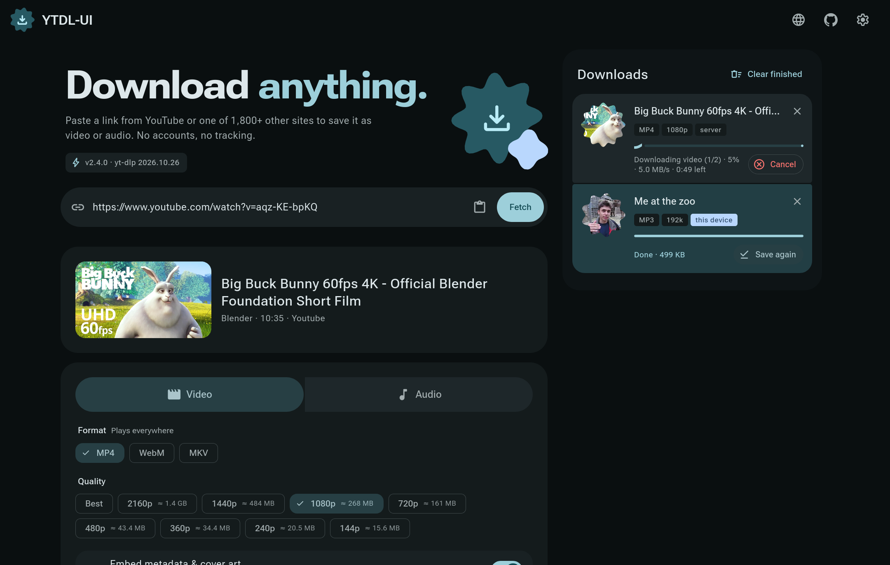
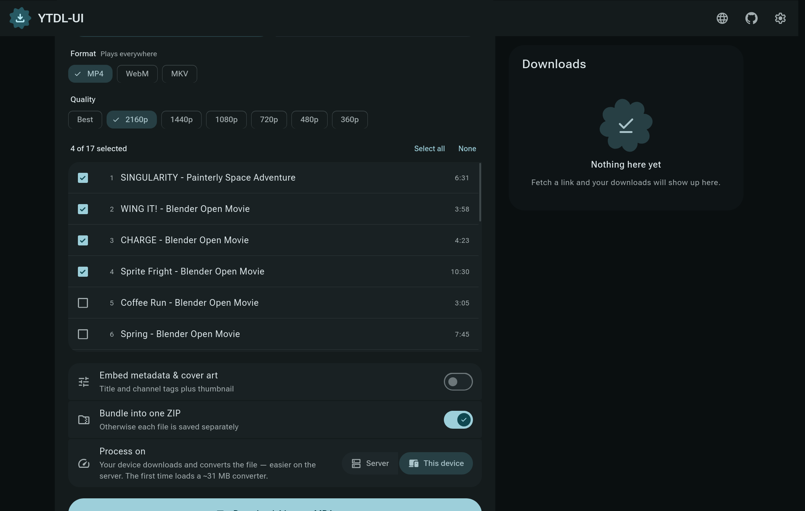
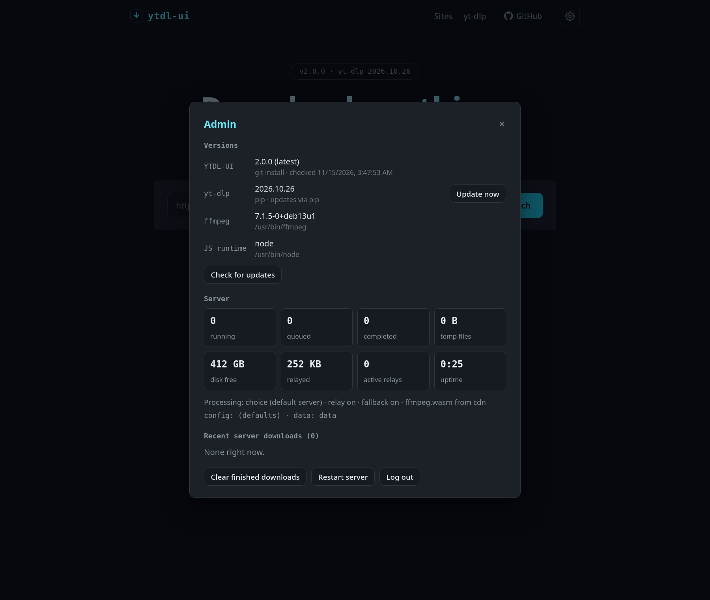

# YTDL-UI

A clean, self-hosted web UI for downloading video and audio from YouTube and 1,800+ other sites — powered by [yt-dlp](https://github.com/yt-dlp/yt-dlp) and [ffmpeg](https://ffmpeg.org). No accounts, no tracking, no ads.

[](https://github.com/JustAyden/YTDL-UI/actions/workflows/ci.yml)
[](https://github.com/JustAyden/YTDL-UI/releases/latest)

<picture>
  <source media="(prefers-color-scheme: light)" srcset="docs/screenshots/main-light.png">
  
</picture>

> Made by [@JustAyden](https://github.com/JustAyden) & [@dash1101](https://github.com/dash1101)

---

## Features

- **Video** — MP4, WebM or MKV at any available resolution (up to 4K/8K), with estimated file sizes
- **Audio** — MP3, M4A, Opus, FLAC or WAV, with title/artist tags and cover art embedded
- **Playlists & channels** — pick exactly which items you want, get them as one ZIP or one-by-one
- **Real progress** — speed, ETA and stage (downloading / merging / converting) for every download, with cancel
- **Process on the server *or* in the visitor's browser** — admins can move the heavy lifting onto users' devices ([how it works](#server-vs-browser-processing))
- **Keeps itself up to date** — yt-dlp updates automatically; YTDL-UI checks GitHub for new releases ([details](#updates))
- **Runs anywhere** — single-file apps for Windows, macOS and Linux (x64 + ARM), a Docker image, or plain Python
- **Built for self-hosting** — admin panel with TOTP two-factor login and brute-force lockouts, bandwidth cap, optional password, rate limits, queue limits, size/duration limits, site allow-list, SSRF protection, reverse-proxy aware
- **Light & dark theme**, works on phones, installable as an app, and accepts links shared from other apps
- **Zero frontend build step** — plain HTML/CSS/JS, no npm, no bundler

---

## Get it

| You want… | Do this |
|---|---|
| **The easy way** (Windows, macOS, Linux) | Download the file for your system from [**Releases**](https://github.com/JustAyden/YTDL-UI/releases/latest) and run it. Your browser opens automatically. |
| **Docker** | `docker run -d -p 5000:5000 -v ytdlui-data:/app/data ghcr.io/justayden/ytdl-ui` |
| **A Linux server** | `git clone https://github.com/JustAyden/YTDL-UI && cd YTDL-UI && sudo sh install.sh` |
| **To run from source** | `./start.sh` (Linux/macOS/BSD/Termux) or `start.bat` (Windows) |

Then open **http://localhost:5000**.

### Supported platforms

| Platform | Ready-made app | Docker | From source |
|---|---|---|---|
| Windows 10/11 (x64) | `ytdl-ui-windows-x64.exe` | ✓ (Docker Desktop) | `start.bat` |
| Windows on ARM | `ytdl-ui-windows-arm64.exe` | | `start.bat` |
| macOS — Apple Silicon | `ytdl-ui-macos-arm64` | ✓ | `start.command` / `start.sh` |
| macOS — Intel | `ytdl-ui-macos-x64` | ✓ | `start.command` / `start.sh` |
| Linux x64 | `ytdl-ui-linux-x64` | ✓ `amd64` | `start.sh` / `install.sh` |
| Linux ARM64 (Raspberry Pi 4/5, ARM servers) | `ytdl-ui-linux-arm64` | ✓ `arm64` | `start.sh` / `install.sh` |
| FreeBSD, 32-bit Raspberry Pi, other Unix | | | `start.sh` |
| Android ([Termux](https://termux.dev)) | | | `pkg install python ffmpeg nodejs` then `./start.sh` |

The ready-made apps bundle Python and yt-dlp. On first start they create `data/` (and read an optional `config.ini`) **next to the executable**. If ffmpeg is missing, the Windows and Linux apps download a static build into `data/bin/` automatically; on macOS run `brew install ffmpeg`.

<details>
<summary>First launch on macOS / Windows shows a warning</summary>

The apps aren't code-signed, so:

- **macOS:** right-click the file → **Open** → **Open**, or run `xattr -d com.apple.quarantine ytdl-ui-macos-arm64 && chmod +x ytdl-ui-macos-arm64`.
- **Windows:** SmartScreen → **More info** → **Run anyway**.

Every release lists SHA-256 checksums in `SHA256SUMS.txt` if you want to verify the download.
</details>

### Requirements for running from source

- **Python 3.10+** — the start scripts create a private `.venv` and install everything else
- **ffmpeg** — `apt install ffmpeg` / `brew install ffmpeg` / `pkg install ffmpeg`, or `python server.py --install-ffmpeg` (Windows/Linux)
- **A JavaScript runtime** — [Deno](https://deno.land) (recommended) or Node.js. yt-dlp needs one to unlock YouTube's higher qualities; without it YouTube may only offer a few low-quality formats.

---

## Server vs. browser processing

Downloading is two jobs: **fetching** the media streams, and **processing** them (merging video + audio, converting to MP3, embedding cover art). YTDL-UI can do the processing in either place:

| | **Server** (default) | **This device** (browser) |
|---|---|---|
| Who runs ffmpeg | the server | the visitor's browser ([ffmpeg.wasm](https://github.com/ffmpegwasm/ffmpeg.wasm)) |
| Server CPU | merging + audio encoding | **none** — the server only asks yt-dlp *which* streams to use |
| Server disk | temp files until the user saves them | **none** |
| Server bandwidth | downloads, then serves the file | streams bytes straight through when the site requires it (see below) — never stored |
| Works for | everything yt-dlp supports | plain-file formats (most sites, including YouTube); HLS-only sites fall back to the server |
| First use | instant | the browser loads a ~31 MB converter once (from jsDelivr by default) |

**Being honest about bandwidth:** some sites — YouTube included — sign their media URLs for the IP address that looked them up and don't allow browsers to fetch them directly. For those, the server *relays* the bytes: it pipes them from the site to the browser as they arrive, without writing to disk or running ffmpeg. Sites that do allow it are fetched by the browser directly, with zero server traffic. A relay token only works for streams yt-dlp resolved on that server, so the relay can't be abused as an open proxy.

Admins choose the behaviour in `config.ini` (or with `YTDLUI_*` environment variables):

```ini
[processing]
# server  – everything on the server (classic behaviour)
# browser – visitors' devices do the processing; the server only resolves streams
# choice  – visitors get a "Process on: Server / This device" switch
processing_mode = choice
# initial choice in "choice" mode: server | browser | auto
#   auto = use the browser when the device looks capable (not on a metered or 2G/3G connection)
processing_default = auto
# if the browser can't handle a link, quietly use the server instead
fallback_to_server = true
# to guarantee the server NEVER downloads files itself:
#   processing_mode = browser  +  fallback_to_server = false
```



---

## Updates

| What | How it updates |
|---|---|
| **yt-dlp** | Automatically, every 24 h, only while no downloads are running. Uses pip when yt-dlp lives in a virtual environment (source installs, Docker), otherwise downloads the official release binary into `data/bin/` after verifying its SHA-256. A missing yt-dlp is installed the same way. |
| **YTDL-UI** | Checks [GitHub releases](https://github.com/JustAyden/YTDL-UI/releases) every 12 h and shows admins a dot on the ⚙ button and the release notes. Install it with any of: |

- **Admin panel → Update** (requires `allow_web_update = true`; the server restarts itself)
- `./update.sh` · `update.bat` · `python server.py --update` · `sudo /opt/ytdlui/update.sh` (systemd install)
- **Ready-made apps** download the new executable, verify its checksum, swap themselves and restart
- **Docker:** `docker compose pull && docker compose up -d`

Git checkouts update with `git pull --ff-only`; extracted archives are updated in place while keeping your `config.ini` and `data/`.



---

## Configuration

Copy [`config.example.ini`](config.example.ini) to `config.ini` — every setting is documented there. Any setting also works as an environment variable (`YTDLUI_PORT=8080`) or on the command line (`--set port=8080`). Precedence: command line › environment › `config.ini` › defaults.

The ones you're most likely to want:

| Setting | Default | What it does |
|---|---|---|
| `host` / `port` | `127.0.0.1` / `5000` | Where to listen. `0.0.0.0` makes it reachable from your network. |
| `password` | *(none)* | Ask visitors for a password before they can use the site. |
| `admin_password` | *(generated)* | Initial admin password for the ⚙ panel. Leave empty to have one generated and printed in the log. The first login forces 2FA setup and a password change. |
| `login_max_attempts` / `login_lockout_minutes` | `5` / `15` | Failed logins per IP before a lockout, and its length (doubles on repeats). |
| `trust_proxy` | `0` | Set to `1` behind Caddy/Nginx/cloudflared (or `cloudflare`) so rate limits see real client IPs. |
| `processing_mode` | `choice` | `server`, `browser` or `choice` — see above. |
| `max_concurrent_jobs` | `2` | Server downloads that run at once; the rest queue. |
| `bandwidth_limit` | `10` | MB/s cap on the media traffic the server handles (served files, ZIPs, relayed streams, and yt-dlp downloads split across job slots). `0` = unlimited. |
| `max_duration_minutes` / `max_filesize_mb` | `0` (off) | Refuse very long or very large downloads. |
| `allowed_sites` | *(any)* | e.g. `youtube.com, youtu.be, soundcloud.com` |
| `cookies_file` | *(none)* | A `cookies.txt` for age-restricted videos and YouTube's "confirm you're not a bot". |
| `ytdlp_auto_update` | `true` | Keep yt-dlp current. |

```bash
python server.py --help          # all command-line options
python server.py --print-config  # the settings currently in effect
python server.py --version       # versions of YTDL-UI, yt-dlp, ffmpeg and the JS runtime
```

---

## Admin panel & two-factor login

Click ⚙ in the top bar. On a new install the initial password is printed in the server log (and saved to `data/initial-admin-password.txt`), unless you set `admin_password`. The first login walks you through:

1. **Turning on two-factor authentication** — scan the QR code with an authenticator app and save the 8 recovery codes.
2. **Choosing a new password** — the initial one stops working.

After that, logging in needs the password **and** a 6-digit code (or a recovery code). The password can be changed from the panel's *Security* section with the current password plus a code; that signs out every other admin session. Too many wrong passwords or codes lock that IP out (5 tries → 15 minutes, doubling each time); locked IPs are listed in the panel with an *Unlock* button. Lost your phone and recovery codes? Run `python server.py --reset-admin` (or `ytdl-ui --reset-admin`) on the server and restart.

## Hosting it for other people

- Keep the default `host = 127.0.0.1` and put a reverse proxy or tunnel in front (Caddy, Nginx, [Cloudflare Tunnel](https://developers.cloudflare.com/cloudflare-one/connections/connect-networks/)), then set `trust_proxy = 1`.
- Downloads run as background jobs, so long playlists work fine behind proxies with short timeouts (Cloudflare's is 100 s).
- Set `password` for a private instance (it gets the same lockout protection), and consider `processing_mode = browser` to keep CPU and disk usage near zero.
- `bandwidth_limit` (10 MB/s by default) keeps downloads from saturating the server's connection — raise it on a fast link, lower it on a home connection you share.
- `sudo sh install.sh` sets up a hardened systemd service (dedicated user, read-only system, restricted syscalls). See **[SETUP.md](SETUP.md)** for a full Debian + Caddy walkthrough, Cloudflare Tunnel and Docker examples.

---

## Troubleshooting

| Problem | Fix |
|---|---|
| *"YouTube is asking this server to prove it isn't a bot"* | Common on cloud/VPS IPs. Export cookies from a logged-in browser (ideally a throwaway account) as `cookies.txt` and set `cookies_file`. A residential connection or `proxy` setting also helps. |
| Only low qualities show up for YouTube | Install [Deno](https://deno.land) (or Node.js) and restart — check with `python server.py --version`. |
| Lots of downloads suddenly fail | yt-dlp is probably outdated: admin panel → **Update yt-dlp**, or `python server.py --update-ytdlp`. |
| *"ffmpeg not found"* | Install ffmpeg, or run `python server.py --install-ffmpeg`. Not needed with `processing_mode = browser`. |
| "This device" falls back to the server | The site only offers HLS/DASH streams, the file is over `browser_max_mb`, or the browser is very old. |
| Port already in use | `--port 8080` |
| Logs | Console window · `journalctl -u ytdlui -f` · `docker logs ytdl-ui` |

---

## API

All endpoints take and return JSON.

| Endpoint | Method | Body / params | Description |
|---|---|---|---|
| `/api/info` | POST | `{url, no_playlist?}` | Metadata, available qualities, playlist entries |
| `/api/jobs` | POST | `{url, format, quality, playlist?, items?, embed?}` | Start a server download → `{id, …}` |
| `/api/jobs?ids=a,b` | GET | | Status of several downloads |
| `/api/jobs/<id>` | GET / DELETE | | Status, or cancel + delete |
| `/api/jobs/<id>/file` | GET | | The finished file (a streamed ZIP for playlists) |
| `/api/jobs/<id>/files/<n>` | GET | | One file of a playlist |
| `/api/resolve` | POST | same as `/api/jobs` | Browser processing: stream plan + relay tokens |
| `/api/download` | POST | `{url, format, quality}` | v1-compatible one-shot download (waits, then returns the file) |
| `/api/download-playlist` | POST | `{url, format, quality}` | v1-compatible playlist ZIP |
| `/api/config` · `/api/health` | GET | | Server capabilities · liveness |

`format` is one of `mp4 webm mkv mp3 m4a opus flac wav`; `quality` is a height like `1080p`/`best` for video or a bitrate like `192k` for audio.

```bash
curl -X POST localhost:5000/api/download -H 'Content-Type: application/json' \
     -d '{"url":"https://youtu.be/aqz-KE-bpKQ","format":"mp3","quality":"192k"}' -OJ
```

---

## Development

```bash
python -m venv .venv && .venv/bin/pip install -r requirements.txt pytest
.venv/bin/python -m pytest              # tests use a fake yt-dlp, no network needed
.venv/bin/python server.py --port 5050  # run it
```

```
server.py            entry point
ytdlui/              config, jobs, browser relay, updater, yt-dlp wrapper, Flask routes
static/              index.html, css/, js/ (app.js UI · engine.js browser processing · ffmpeg-worker.js)
packaging/           PyInstaller spec, build + smoke-test scripts for the standalone apps
tests/               pytest suite
```

**Releasing:** bump `__version__` in `ytdlui/__init__.py`, add a section to [`CHANGELOG.md`](CHANGELOG.md), then push a tag (`git tag v2.0.1 && git push --tags`). GitHub Actions builds and smoke-tests the apps for every platform, publishes them with checksums as a GitHub release — which is what running installs pick up as their update — and pushes the multi-arch Docker image to `ghcr.io`.

---

## License

[MIT](LICENSE) — do whatever you want with it.

yt-dlp is [Unlicense](https://github.com/yt-dlp/yt-dlp/blob/master/LICENSE); ffmpeg and ffmpeg.wasm are LGPL/GPL and are downloaded from their upstream projects, not shipped in this repository. Only download content you have the right to.
